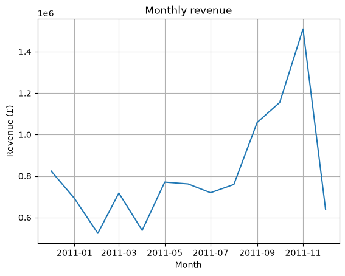
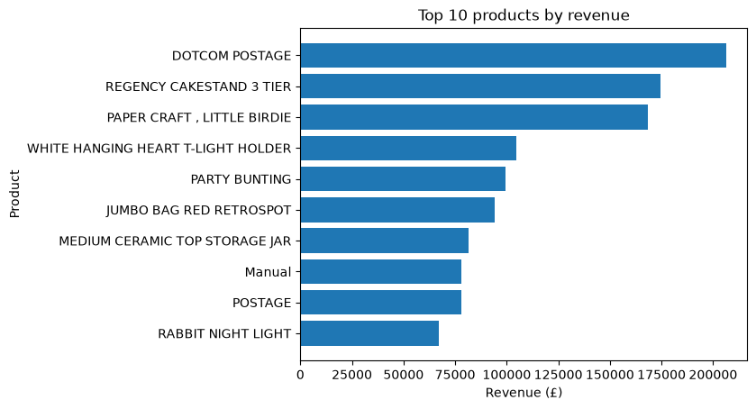
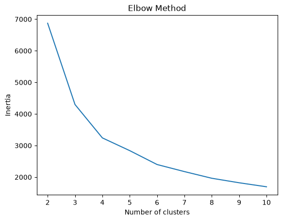
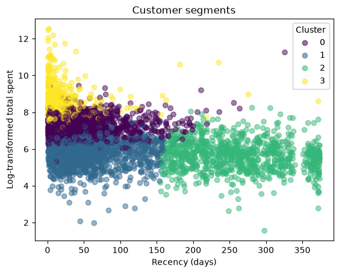

# E-Commerce Analytics

An end-to-end data analytics project using Python, PostgreSQL, SQL, and machine learning to analyze the UCI Online Retail dataset.

The project covers data exploration and cleaning, relational database design, SQL analysis, visualization, and customer segmentation using K-Means clustering.

## Tech Stack

- Python
- pandas & NumPy
- PostgreSQL
- psycopg & SQLAlchemy
- Matplotlib
- scikit-learn

## Dataset & Data Cleaning

The project uses the **UCI Online Retail dataset**, containing transactions from a UK-based online retailer between 2010 and 2011.

The original dataset contains **541,909 rows**.

During cleaning, transactions are retained when:

- `Quantity > 0`
- `UnitPrice > 0`
- `InvoiceNo` does not start with `C` (cancellations)

Transactions without a `CustomerID` are retained for general sales analysis but excluded from customer-level analysis.

After cleaning, **530,104 transaction rows** remain.

The dataset itself is not included in this repository and must be placed at:

```text
data/Online_Retail.xlsx
```

## Database

The cleaned data is transformed into four relational PostgreSQL tables:

- `products` — product information
- `customers` — unique customers
- `orders` — one row per invoice
- `order_items` — individual products within each order

The final database contains:

| Table | Rows |
|---|---:|
| products | 3,922 |
| customers | 4,338 |
| orders | 19,960 |
| order_items | 530,104 |

Data is loaded into PostgreSQL using `COPY` through psycopg.

## Analysis

SQL and Python are used to analyze:

- Total and monthly revenue
- Revenue and orders by country
- Top products by revenue
- Top customers
- Average order value
- Products frequently purchased together

### Monthly Revenue



### Top Products



## Customer Segmentation

Customer-level data is created using RFM characteristics:

- **Recency** — days since the customer's last purchase
- **Frequency** — number of orders
- **Monetary value** — total amount spent

Because order frequency and customer spending are strongly skewed, these features are log-transformed. The clustering features are then standardized with `StandardScaler` so differences in numeric scale do not dominate K-Means.

The Elbow Method is used to compare different values of `k`.



Four clusters were selected as a balance between cluster compactness and interpretability.

| Cluster | Avg. Recency | Avg. Orders | Avg. Total Spent | Customers | Interpretation |
|---|---:|---:|---:|---:|---|
| 0 | ~46 days | ~4.2 | ~£1,645 | 1,449 | Regular Customers |
| 1 | ~260 days | ~1.4 | ~£387 | 937 | Inactive Customers |
| 2 | ~20 days | ~15.7 | ~£9,736 | 579 | High-Value Customers |
| 3 | ~58 days | ~1.5 | ~£384 | 1,373 | Occasional Customers |

Cluster numbers are arbitrary labels assigned by K-Means. The interpretations are based on the original customer metrics.

### Customer Segments

The visualization below shows a two-dimensional view of the clusters using recency and log-transformed customer spending. The clustering itself uses all three RFM features.



## Project Structure

```text
ecommerce-analytics/
├── data/
├── figures/
├── sql/
│   ├── create_tables.sql
│   └── analysis_queries.sql
├── explore_data.py
├── clean_data.py
├── prepare_tables.py
├── load_database.py
├── analyze_data.py
├── .env.example
├── requirements.txt
└── README.md
```

## Setup

1. Install the required Python packages:

```bash
pip install -r requirements.txt
```

2. Download the UCI Online Retail dataset and place it at:

```text
data/Online_Retail.xlsx
```

3. Create a PostgreSQL database named `ecommerce_analytics` and run:

```text
sql/create_tables.sql
```

4. Copy `.env.example` to `.env` and enter your PostgreSQL credentials.

5. Load the cleaned data into PostgreSQL:

```bash
python load_database.py
```

6. Run the analysis:

```bash
python analyze_data.py
```

Additional SQL queries can be found in `sql/analysis_queries.sql`.